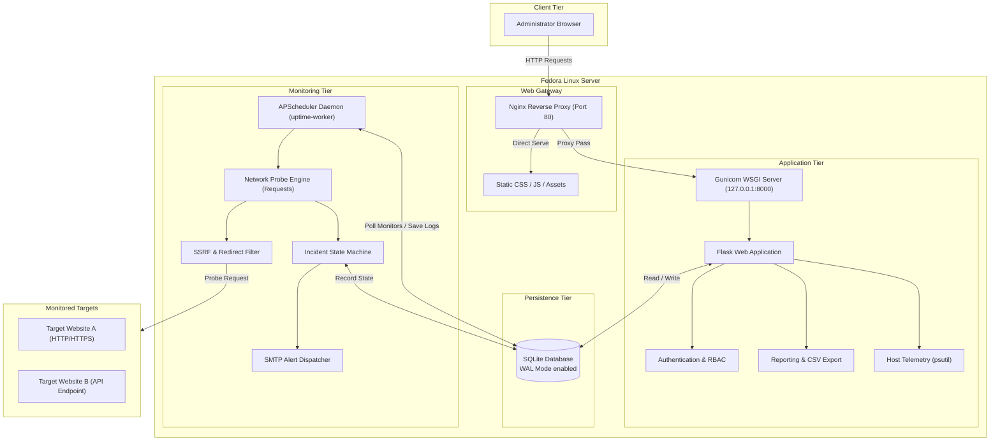
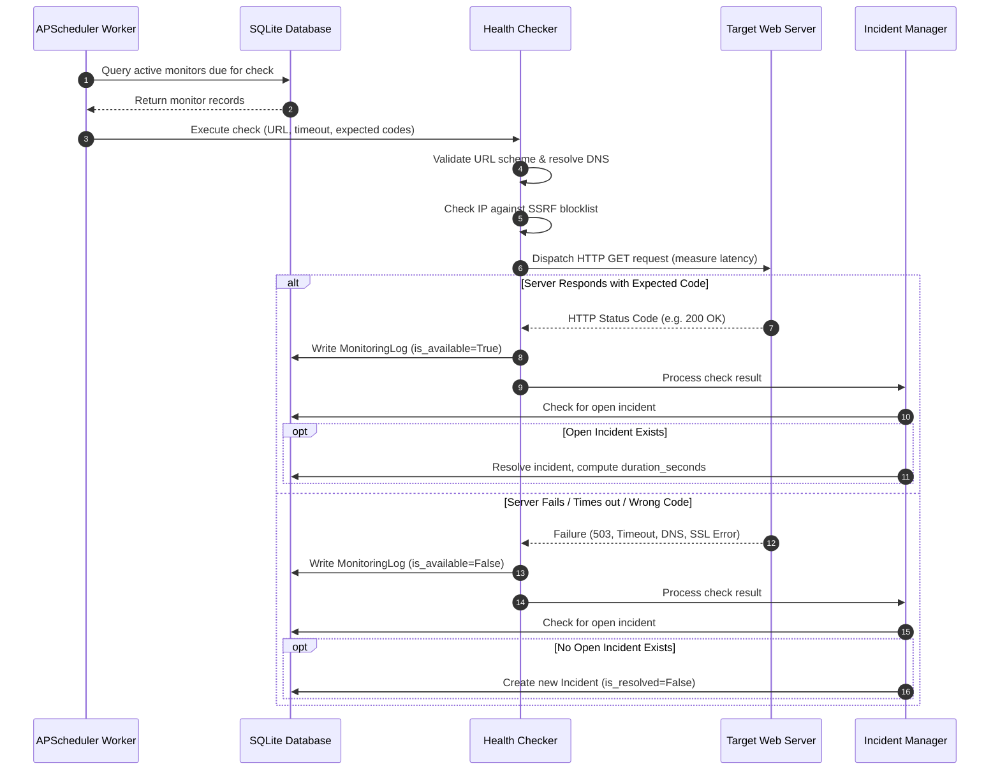
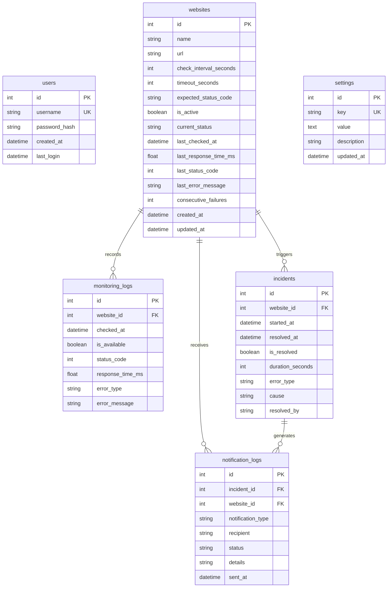

# Linux Automated Website Uptime Monitoring System

An academic infrastructure monitoring platform developed with Python 3, Flask, SQLite, SQLAlchemy, APScheduler, Gunicorn, Nginx, and Systemd, designed for deployment on Fedora Linux.

---

## Table of Contents

1. [Project Overview](#project-overview)
2. [Objectives](#objectives)
3. [Key Features](#key-features)
4. [Technology Stack](#technology-stack)
5. [System Architecture](#system-architecture)
6. [Monitoring Workflow](#monitoring-workflow)
7. [Database Schema](#database-schema)
8. [Project Structure](#project-structure)
9. [Fedora Linux Deployment Guide](#fedora-linux-deployment-guide)
   - [Prerequisites](#prerequisites)
   - [VMware Network Configuration](#vmware-network-configuration)
   - [Clone Repository](#clone-repository)
   - [Automated Deployment Script](#automated-deployment-script)
   - [Manual Step-by-Step Deployment](#manual-step-by-step-deployment)
10. [Local Development (Windows / Linux)](#local-development-windows--linux)
11. [Testing & Outage Demonstration](#testing--outage-demonstration)
12. [Troubleshooting & Diagnostics](#troubleshooting--diagnostics)
13. [Screenshots](#screenshots)
14. [Future Enhancements](#future-enhancements)
15. [License](#license)

---

## Project Overview

The **Linux Automated Website Uptime Monitoring System** is a self-hosted infrastructure monitoring solution. It decouples administrative web presentation from high-precision background health checks using a dedicated APScheduler daemon.

The application adheres to production Linux server standards, utilizing Nginx as a reverse proxy, Gunicorn as the WSGI server, Systemd for process supervision, Firewalld for network perimeter defense, and SELinux in enforcing mode with targeted network socket permissions.

---

## Objectives

- Deliver real-time status visibility across registered HTTP/HTTPS web endpoints.
- Maintain check-based uptime metrics and latency measurements in milliseconds.
- Detect and classify failures (HTTP errors, connection timeouts, DNS resolution failures, and SSL/TLS certificate errors).
- Implement an automated incident lifecycle (detection, deduplication, duration tracking, and resolution upon recovery).
- Provide host telemetry (CPU, RAM, Disk, Load Average, Uptime) via Python `psutil`.
- Enforce security best practices, including SSRF defenses, redirect validation, CSRF tokens, and secure session management.

---

## Key Features

- **Decoupled Architecture:** Background scheduling runs independently of Flask/Gunicorn worker processes to avoid duplicate or missed checks.
- **SSRF Defense Engine:** Validates target URLs and DNS-resolved IPs, blocking loopback, link-local, and private RFC-1918 subnets by default, with an explicit localhost override mode for academic testing.
- **Incident State Machine:** Creates tracked incidents upon initial downtime, prevents duplicate open incidents during prolonged outages, and computes exact outage durations upon recovery.
- **Modern Infrastructure Dashboard:** Light slate UI built with Bootstrap 5, Chart.js, and Lucide icons.
- **System Telemetry:** Real-time host statistics updating automatically every 5 seconds.
- **Data Export:** CSV exports for raw health check logs and incident history.
- **Fedora Automation:** Automated deployment script configuring DNF packages, SELinux policies, Firewalld ports, Nginx proxy rules, and systemd units.

---

## Technology Stack

| Layer | Component | Description |
|---|---|---|
| **Language** | Python 3 | Core runtime environment (tested on 3.10+) |
| **Web Framework** | Flask 3.x | Lightweight WSGI web application framework |
| **ORM & Database** | SQLAlchemy & SQLite | Relational persistence with WAL mode and foreign key constraints |
| **Scheduler** | APScheduler 3.x | Threaded background monitoring engine |
| **HTTP Client** | Python Requests | HTTP/HTTPS network probe and redirect inspector |
| **System Telemetry**| psutil | Hardware performance and kernel metrics collector |
| **Frontend** | HTML5, CSS3, JS, Bootstrap 5 | Clean, responsive management dashboard |
| **Visualizations** | Chart.js | Latency trends and availability graphs |
| **Icons** | Lucide Icons | Clean infrastructure iconography |
| **WSGI Server** | Gunicorn | Production Python WSGI HTTP server |
| **Web Server** | Nginx | Reverse proxy, static asset delivery, and SSL termination |
| **Process Manager** | Systemd | Linux service supervision and reboot persistence |
| **OS Platform** | Fedora Linux (38+) | Target production operating system |

---

## System Architecture



---

## Monitoring Workflow



---

## Database Schema



---

## Project Structure

```text
linux-uptime-monitor/
├── app/
│   ├── __init__.py               # Application factory, extensions, CLI commands
│   ├── models.py                 # SQLAlchemy relational database models
│   ├── forms.py                  # WTForms CSRF-protected input validation
│   ├── routes/
│   │   ├── __init__.py
│   │   ├── auth.py               # Login, session management, password changes
│   │   ├── dashboard.py          # Overview metrics, charts, auto-refresh API
│   │   ├── websites.py           # Monitor CRUD, latency charts, manual checks
│   │   ├── incidents.py          # Incident lifecycle and root cause inspection
│   │   ├── reports.py            # CSV export and analytical summaries
│   │   ├── system.py             # Host performance telemetry via psutil
│   │   └── settings.py           # Monitoring defaults and SMTP configuration
│   ├── services/
│   │   ├── __init__.py
│   │   ├── checker.py            # SSRF-safe probe engine and redirect handler
│   │   ├── incident_manager.py   # State machine for incident creation/recovery
│   │   ├── notifier.py           # Optional SMTP notification dispatcher
│   │   └── system_info.py        # Host hardware metrics collector
│   ├── templates/                # Bootstrap 5 HTML templates
│   │   ├── base.html
│   │   ├── auth/
│   │   ├── dashboard/
│   │   ├── websites/
│   │   ├── incidents/
│   │   ├── reports/
│   │   ├── system/
│   │   ├── settings/
│   │   └── errors/
│   └── static/
│       ├── css/style.css         # UI design system
│       └── js/main.js            # Frontend interactivity
├── monitoring/
│   ├── __init__.py
│   └── worker.py                 # Standalone APScheduler background daemon
├── deployment/
│   ├── nginx/
│   │   └── uptime-monitor.conf   # Nginx reverse proxy virtual host
│   └── systemd/
│       ├── uptime-monitor.service # Gunicorn application service
│       └── uptime-worker.service  # APScheduler monitoring worker service
├── scripts/
│   ├── setup_fedora.sh           # Automated Fedora Linux installer
│   └── test_server.py            # Controlled academic HTTP test server
├── tests/
│   ├── conftest.py               # Pytest in-memory database fixtures
│   ├── test_auth.py              # Authentication test suite
│   ├── test_websites.py          # Website CRUD and SSRF security tests
│   ├── test_monitoring.py        # Probe execution and failure test suite
│   ├── test_incidents.py         # Incident lifecycle and recovery tests
│   └── test_uptime.py            # Uptime calculation and CSV export tests
├── instance/                     # SQLite database directory (created at runtime)
├── screenshots/                  # Documentation images
├── docs/                         # Technical specifications
├── run.py                        # Development entry point
├── wsgi.py                       # Production WSGI entry point
├── requirements.txt              # Project dependencies
├── .env.example                  # Environment configuration template
├── .gitignore                    # Git ignore file
├── README.md                     # Documentation
└── LICENSE                       # License information
```

---

## Fedora Linux Deployment Guide

### Prerequisites

- A running instance of **Fedora Linux** (Fedora 38, 39, or 40 recommended) running on hardware or in a VMware Workstation / Player virtual machine.
- Root or `sudo` access on the Fedora system.

### VMware Network Configuration

When running Fedora Linux inside VMware:

1. Open your virtual machine settings in VMware.
2. Select **Network Adapter** and choose:
   - **Bridged Mode:** If you want the Fedora VM to receive its own distinct IP address on your physical local network.
   - **NAT Mode:** If you want the VM to share the host IP address via VMware virtual NAT.
3. Open a terminal inside Fedora and determine your assigned IP address:
   ```bash
   ip -br addr show
   # or
   hostname -I
   ```
   *Example output: `192.168.122.50`*

### Clone Repository

Replace `<YOUR_GITHUB_REPOSITORY_URL>` with your repository URL:

```bash
cd ~
git clone <YOUR_GITHUB_REPOSITORY_URL> linux-uptime-monitor
cd linux-uptime-monitor
```

### Automated Deployment Script

The included script automates package installation, virtual environment setup, user creation, database migration, Nginx reverse proxy configuration, SELinux policy adjustments, and Systemd activation.

```bash
chmod +x scripts/setup_fedora.sh
sudo ./scripts/setup_fedora.sh
```

Upon completion, the installer will display your server IP, administrator credentials, and service status.

---

### Manual Step-by-Step Deployment

If you prefer to configure the deployment manually, execute the following steps:

#### 1. Install System Dependencies via DNF
```bash
sudo dnf install -y python3 python3-devel python3-pip gcc nginx firewalld policycoreutils-python-utils sqlite
```

#### 2. Create Unprivileged System User
```bash
sudo useradd --system --shell /sbin/nologin --comment "Uptime Monitor Service User" uptimemon
```

#### 3. Setup Application Directory
```bash
sudo mkdir -p /opt/linux-uptime-monitor
sudo mkdir -p /var/log/uptime-monitor
sudo cp -r ~/linux-uptime-monitor/* /opt/linux-uptime-monitor/
cd /opt/linux-uptime-monitor
```

#### 4. Configure Virtual Environment & Dependencies
```bash
sudo python3 -m venv venv
sudo ./venv/bin/pip install --upgrade pip
sudo ./venv/bin/pip install -r requirements.txt
sudo ./venv/bin/pip install gunicorn
```

#### 5. Configure Production Environment
```bash
sudo cp .env.example .env
sudo chown -R uptimemon:uptimemon /opt/linux-uptime-monitor
sudo chown -R uptimemon:uptimemon /var/log/uptime-monitor
sudo chmod 770 /opt/linux-uptime-monitor/instance
```

#### 6. Initialize Database & Create Initial Admin
```bash
sudo -u uptimemon ./venv/bin/flask init-db
sudo -u uptimemon ./venv/bin/flask create-admin --username admin --password "StrongAdminPass123!"
```

#### 7. Configure SELinux & Firewalld
Enable HTTP traffic through the firewall and permit Nginx to proxy to Gunicorn without disabling security controls:
```bash
# Allow Nginx reverse proxy connections
sudo setsebool -P httpd_can_network_connect 1

# Open port 80 in Firewalld
sudo firewall-cmd --permanent --add-service=http
sudo firewall-cmd --reload
```

#### 8. Configure Nginx Reverse Proxy
```bash
sudo cp deployment/nginx/uptime-monitor.conf /etc/nginx/conf.d/
sudo nginx -t
sudo systemctl enable --now nginx
sudo systemctl reload nginx
```

#### 9. Install and Enable Systemd Services
```bash
sudo cp deployment/systemd/uptime-monitor.service /etc/systemd/system/
sudo cp deployment/systemd/uptime-worker.service /etc/systemd/system/

sudo systemctl daemon-reload
sudo systemctl enable --now uptime-monitor.service
sudo systemctl enable --now uptime-worker.service
```

---

## Local Development (Windows / Linux)

For local development or testing:

```bash
# 1. Clone repository
git clone <YOUR_GITHUB_REPOSITORY_URL> linux-uptime-monitor
cd linux-uptime-monitor

# 2. Create virtual environment
python -m venv venv

# Windows:
.\venv\Scripts\activate
# Linux / macOS:
source venv/bin/activate

# 3. Install dependencies
pip install -r requirements.txt

# 4. Copy configuration
copy .env.example .env   # (Windows)
cp .env.example .env     # (Linux)

# Enable localhost monitoring in .env for local testing:
# ALLOW_LOCALHOST_MONITORING=true

# 5. Initialize database & admin
flask init-db
flask create-admin --username admin --password admin

# 6. Run web application (Terminal 1)
python run.py

# 7. Run background monitoring worker (Terminal 2)
python monitoring/worker.py
```

Access the application in your browser at `http://127.0.0.1:5000`.

---

## Testing & Outage Demonstration

A controlled HTTP test server is included to demonstrate health checks, failure detection, and automatic recovery.

### 1. Launch the Test Server
In a separate terminal, run:
```bash
python scripts/test_server.py --port 8085
```
This serves a test endpoint on `http://127.0.0.1:8085`.

### 2. Register the Monitor
1. In `.env`, ensure `ALLOW_LOCALHOST_MONITORING=true` is set.
2. Sign in to the dashboard (`http://127.0.0.1:5000` or your Linux server IP).
3. Navigate to **Add Monitor**.
4. Enter:
   - **Name:** Local Academic Test Service
   - **Target URL:** `http://127.0.0.1:8085/dynamic`
   - **Check Interval:** `10` seconds
   - **Timeout:** `5` seconds
   - **Expected Status Code:** `200`
5. Save the monitor.

### 3. Simulate Website Outage
Open a browser or terminal and trigger an outage:
```bash
curl http://127.0.0.1:8085/simulate/down
```
- The test server will begin returning **HTTP 503 Service Unavailable**.
- Within 10 seconds, the monitoring worker will detect the failure.
- The monitor status will switch to **Down** on the dashboard.
- A new tracked incident will automatically appear under **Incidents**.

### 4. Simulate Website Recovery
Recover the test server:
```bash
curl http://127.0.0.1:8085/simulate/recover
```
- The test server returns to **HTTP 200 OK**.
- On the next check cycle, the worker records a successful check.
- The incident is automatically marked **Resolved**, and the total outage duration in seconds is calculated and displayed.

### 5. Run Automated Test Suite
Run the 23 automated unit and integration tests using pytest:
```bash
pytest -v
```

---

## Troubleshooting & Diagnostics

### Check Service Status
```bash
sudo systemctl status uptime-monitor.service
sudo systemctl status uptime-worker.service
sudo systemctl status nginx
```

### Inspect Application Logs
```bash
# Web application logs
sudo tail -f /var/log/uptime-monitor/gunicorn-error.log

# Background worker monitoring logs
sudo tail -f /var/log/uptime-monitor/worker.log

# Nginx error logs
sudo journalctl -u nginx -e --no-pager
```

### SELinux Permission Issues
If Nginx returns an `HTTP 502 Bad Gateway` error, verify SELinux network connect permissions:
```bash
sudo getsebool httpd_can_network_connect
# If disabled, enable with:
sudo setsebool -P httpd_can_network_connect 1
```

### Reset Administrator Password
```bash
cd /opt/linux-uptime-monitor
sudo -u uptimemon ./venv/bin/flask create-admin --username admin --password "NewPassword123!"
```

---

## Screenshots

| Overview Dashboard | Monitor Analytics |
|---|---|
| *(See screenshots/01_overview_dashboard.png)* | *(See screenshots/03_website_detail_analytics.png)* |

| Incident Management | System Telemetry |
|---|---|
| *(See screenshots/04_incident_management.png)* | *(See screenshots/05_system_telemetry.png)* |

---

## Future Enhancements

- Webhook and Slack/Discord incident notification integrations.
- Multi-location probe distribution via distributed worker agents.
- TLS/SSL certificate expiration warning alerts (e.g. 14 days before expiry).
- Multi-factor authentication (TOTP/2FA) for administrators.

---

## License

This project is licensed under the academic project license. See the [LICENSE](LICENSE) file for details.
