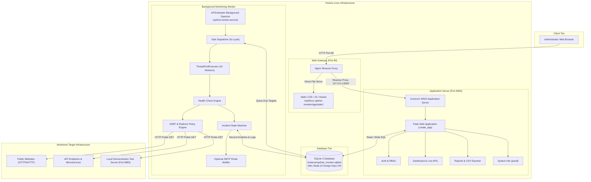
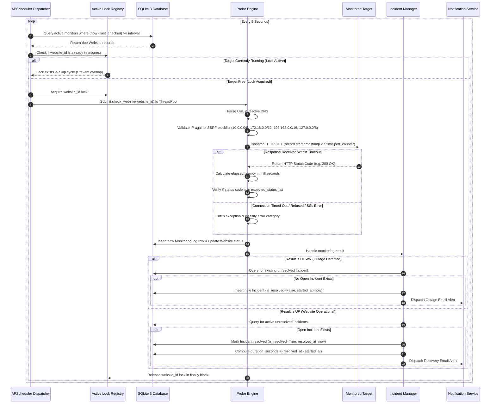
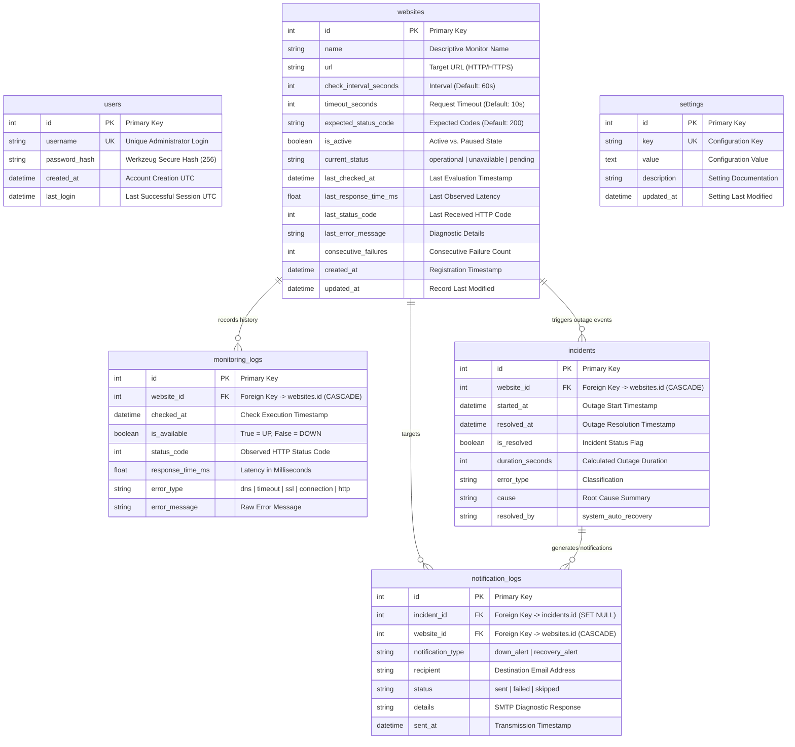

# 🛰️ Linux Automated Website Uptime Monitoring System

### Self-hosted uptime monitoring, incident tracking and host telemetry for Fedora Linux


> An academic infrastructure monitoring platform developed with **Python 3, Flask, SQLite, SQLAlchemy, APScheduler, Gunicorn, Nginx, and Systemd**, designed for **development on Windows** and **production deployment on Fedora Linux**.

**[Overview](#1-project-overview)**  •  **[Architecture](#5-system-architecture-diagram)**  •  **[Deploy](#11-automated-fedora-linux-deployment)**  •  **[Local Dev](#13-local-development-guide-windows--linux)**  •  **[Testing](#17-automated-pytest-test-suite)**  •  **[Security](#20-security-posture--ssrf-defense-matrix)**

---

## ✨ Highlights

| 🧩 Decoupled Design | 🚨 Smart Incidents | 🛡️ Security First | 📊 Clear Insights |
|:---:|:---:|:---:|:---:|
| Web app and scheduler run as separate services | Deduplicated outages with automatic recovery | SSRF checks, CSRF protection, SELinux Enforcing | Latency charts, uptime metrics, CSV exports |

---

## Table of Contents

| Section | Topics |
|---|---|
| 📘 **Foundation** | [1. Project Overview](#1-project-overview) <br> [2. Academic Objectives & Engineering Goals](#2-academic-objectives--engineering-goals) <br> [3. Key Architecture & Technical Features](#3-key-architecture--technical-features) <br> [4. Technology Stack](#4-technology-stack) |
| 🏗️ **Design** | [5. System Architecture Diagram](#5-system-architecture-diagram) <br> [6. Monitoring Workflow Engine](#6-monitoring-workflow-engine) <br> [7. Database Schema & Relational Models](#7-database-schema--relational-models) <br> [8. Complete Project Folder Structure](#8-complete-project-folder-structure) |
| 🚀 **Deployment** | [9. Fedora Linux Prerequisites & Setup](#9-fedora-linux-prerequisites--setup) <br> [10. VMware Workstation Network Configuration](#10-vmware-workstation-network-configuration) <br> [11. Automated Fedora Linux Deployment](#11-automated-fedora-linux-deployment) <br> [12. Manual Step-by-Step Fedora Linux Deployment](#12-manual-step-by-step-fedora-linux-deployment) |
| 💻 **Usage** | [13. Local Development Guide](#13-local-development-guide-windows--linux) <br> [14. Application Access & Dashboard Navigation](#14-application-access--dashboard-navigation) <br> [15. Monitoring Demonstration & Verification](#15-monitoring-demonstration--verification) <br> [16. Controlled Outage & Recovery Testing](#16-controlled-outage--recovery-testing) |
| 🔧 **Quality & Support** | [17. Automated Pytest Test Suite](#17-automated-pytest-test-suite) <br> [18. Troubleshooting & Diagnostics](#18-troubleshooting--diagnostics) <br> [19. Screenshot Gallery](#19-screenshot-gallery) <br> [20. Security Posture & SSRF Defense Matrix](#20-security-posture--ssrf-defense-matrix) |
| 🔭 **Closing** | [21. Future Enhancements](#21-future-enhancements) <br> [22. Conclusion & Engineering Retrospective](#22-conclusion--engineering-retrospective) <br> [23. License](#23-license) |

---

## 1. Project Overview

The **Linux Automated Website Uptime Monitoring System** is an infrastructure observability and health-checking solution designed for enterprise Linux environments. Developed on Windows and engineered specifically for production deployment on **Fedora Linux**, the system monitors the continuous availability, HTTP status codes, latency in milliseconds, and SSL/DNS stability of registered websites and API endpoints.

Unlike monolithic web applications that run scheduling routines within the web server threads, this system **decouples** two tiers:

| Tier | Powered By | Responsibility |
|---|---|---|
| 🖥️ **Presentation** | Gunicorn + Nginx reverse proxy | Serves the dashboard and APIs |
| ⏱️ **Monitoring** | Standalone APScheduler daemon under Systemd | Evaluates target health |

All operational state is persisted in an embedded **SQLite 3** database operating under **Write-Ahead Logging (WAL)** mode for concurrent read-write performance.

---

## 2. Academic Objectives & Engineering Goals

| Objective | Description |
|---|---|
| 🧩 **Decoupled Process Architecture** | Eliminate background scheduling race conditions and duplicate job triggers caused by multi-process WSGI server workers. |
| ⏱️ **Accurate Metric Gathering** | Measure real network round-trip latency in milliseconds using high-resolution monotonic timing (`time.perf_counter()`). |
| 🔍 **Comprehensive Failure Classification** | Differentiate network-level connection refusals, DNS resolution failures, TLS/SSL certificate invalidities, HTTP status code deviations, and connection timeouts. |
| 🚨 **Automated Incident Lifecycle** | Automatically detect outages, deduplicate open incidents during sustained downtime, timestamp recovery events, and calculate observed outage duration in seconds. |
| 📈 **Host Infrastructure Telemetry** | Real-time visibility into the Linux server's own CPU utilization, RAM usage, storage availability, and system uptime using `psutil`. |
| 🛡️ **Hardened Security Posture** | Prevent Server-Side Request Forgery (SSRF) attacks by inspecting resolved target IPs and redirect chains against private/reserved subnets. |
| 🐧 **Production Linux Standards** | Deploy services under a dedicated unprivileged user, preserve SELinux in Enforcing mode using granular Boolean permissions, and manage firewalls with `firewalld`. |

---

## 3. Key Architecture & Technical Features

- ⚡ **Asynchronous Health Checking:** Non-blocking multi-threaded target evaluation with in-memory lock registries that guarantee overlapping checks for the same website cannot occur.
- 🧮 **Check-Based Uptime Calculation:** Mathematically rigorous uptime metrics, avoiding guesswork or fabricated statistics:

  > **Uptime (%) = (Successful Checks ÷ Total Completed Checks) × 100**

- 🎛️ **Configurable Monitor Parameters:** Custom check intervals (10s to 86,400s), HTTP request timeouts (1s to 60s), and expected HTTP status codes (e.g. `200` or comma-separated lists like `200, 201, 204, 301`).
- 📊 **Interactive Visualizations:** Client-side Chart.js dashboards showing 24-hour hourly latency trends and monitor-specific performance history.
- 📑 **Reports & Analytical CSV Exports:** Filter monitoring logs and incident records by date range and target website, with single-click CSV export generation.
- ✉️ **Optional SMTP Alerts:** Automated email dispatch to DevOps personnel when monitors transition between operational and down states, complete with an audit log table.
- 🎨 **Clean UI/UX Design System:** Responsive dashboard adhering to modern infrastructure management ergonomics with white/slate backgrounds, blue accents, status indicator badges, and Lucide icons.

---

## 4. Technology Stack

### ⚙️ Backend & Data

| Layer | Component | Specification / Purpose |
|---|---|---|
| **Programming Language** | Python 3.10+ | Core language (Type-annotated, modular design) |
| **Web Framework** | Flask 3.x | Lightweight, micro-framework for web presentation and REST APIs |
| **Object-Relational Mapping** | SQLAlchemy 2.x | Database abstraction, relational mapping, and parameter binding |
| **Persistence Engine** | SQLite 3 | Relational database with WAL mode, foreign keys, and 5000ms busy timeout |
| **Scheduler Engine** | APScheduler 3.x | Background job scheduler driving non-blocking probe worker cycles |
| **HTTP Client Library** | Requests 2.x | Network probe execution, manual redirect inspection, and SSL handling |
| **Form & Security Suite** | Flask-WTF / WTForms | CSRF protection, input sanitation, and form validation |
| **Authentication System** | Flask-Login | Session-based authentication and secure cookie management |
| **System Telemetry** | psutil | Kernel-level CPU, RAM, Disk, and system boot telemetry collection |

### 🎨 Frontend

| Layer | Component | Specification / Purpose |
|---|---|---|
| **Frontend Framework** | Bootstrap 5.3 | Responsive CSS framework with custom light slate theme |
| **Data Visualization** | Chart.js 4.x | Interactive latency trend lines and availability gauges |
| **Iconography** | Lucide Icons | Clean SVG infrastructure icons |

### 🐧 Infrastructure

| Layer | Component | Specification / Purpose |
|---|---|---|
| **WSGI Server** | Gunicorn | Production Python WSGI server (3 worker processes bound to 127.0.0.1:8000) |
| **Reverse Proxy** | Nginx | Front-facing reverse proxy, static asset handler, and header forwarder |
| **Process Supervision** | Systemd | Linux service lifecycle supervisor ensuring auto-start on boot |
| **Security Controls** | SELinux & Firewalld | Enforcing Mandatory Access Control and host firewall rules |
| **Operating System** | Fedora Linux (38+) | Target production operating system (RPM/DNF-based) |

---

## 5. System Architecture Diagram



---

## 6. Monitoring Workflow Engine



---

## 7. Database Schema & Relational Models



---

## 8. Complete Project Folder Structure

```text
linux-uptime-monitor/
├── app/
│   ├── __init__.py               # Application factory, extensions, WAL pragmas, CLI commands
│   ├── models.py                 # SQLAlchemy relational database models with explicit constructors
│   ├── forms.py                  # WTForms CSRF-protected input validation forms
│   ├── routes/
│   │   ├── __init__.py           # Routes package initializer
│   │   ├── auth.py               # Authentication, login, logout, password modification
│   │   ├── dashboard.py          # Dashboard overview metrics & live auto-refresh API
│   │   ├── websites.py           # Monitor CRUD, manual checks, Chart.js time-series API
│   │   ├── incidents.py          # Incident lifecycle, diagnostics & root cause inspection
│   │   ├── reports.py            # Analytics summary & CSV export handlers
│   │   ├── system.py             # Host performance metrics via psutil
│   │   └── settings.py           # Monitoring defaults & SMTP configuration
│   ├── services/
│   │   ├── __init__.py           # Services package initializer
│   │   ├── checker.py            # SSRF-safe probe engine, timing & redirect validation
│   │   ├── incident_manager.py   # State machine for incident deduplication & resolution
│   │   ├── notifier.py           # Optional SMTP incident alert delivery
│   │   └── system_info.py        # Host hardware telemetry collector
│   ├── templates/                # Bootstrap 5 HTML templates
│   │   ├── base.html             # Responsive shell with sidebar navigation
│   │   ├── auth/
│   │   │   ├── login.html        # Clean administrative sign-in card
│   │   │   └── change_password.html # Password update form
│   │   ├── dashboard/
│   │   │   └── index.html        # Infrastructure overview & latency trend charts
│   │   ├── websites/
│   │   │   ├── index.html        # Monitors inventory & status pills
│   │   │   ├── detail.html       # Individual website analytics & recent 50 logs
│   │   │   └── form.html         # Add / Edit monitor form
│   │   ├── incidents/
│   │   │   ├── index.html        # Filterable incidents tracker
│   │   │   └── detail.html       # Outage diagnostics & notification logs
│   │   ├── reports/
│   │   │   └── index.html        # Summary metrics & CSV export buttons
│   │   ├── system/
│   │   │   └── index.html        # Live hardware gauges (CPU, RAM, Disk, Uptime)
│   │   ├── settings/
│   │   │   └── index.html        # System parameters & SMTP diagnostic mailer
│   │   └── errors/
│   │       ├── 403.html          # Forbidden error template
│   │       ├── 404.html          # Page not found error template
│   │       └── 500.html          # Internal server error template
│   └── static/
│       ├── css/
│       │   └── style.css         # UI design system & status dot indicators
│       └── js/
│           └── main.js           # Frontend interactivity & Lucide icon initializers
├── monitoring/
│   ├── __init__.py               # Monitoring package initializer
│   └── worker.py                 # Standalone APScheduler background daemon
├── deployment/
│   ├── nginx/
│   │   └── uptime-monitor.conf   # Fedora Nginx reverse proxy virtual host configuration
│   └── systemd/
│       ├── uptime-monitor.service # Gunicorn systemd service unit
│       └── uptime-worker.service  # APScheduler monitoring daemon systemd unit
├── scripts/
│   ├── setup_fedora.sh           # Automated deployment script for Fedora Linux
│   └── test_server.py            # Controlled academic HTTP test server (200, 503, slow, recovery)
├── tests/
│   ├── conftest.py               # Pytest in-memory SQLite fixtures & authenticated clients
│   ├── test_auth.py              # Authentication test suite
│   ├── test_websites.py          # Website CRUD and SSRF security tests
│   ├── test_monitoring.py        # Probe execution and failure test suite
│   ├── test_incidents.py         # Incident lifecycle and recovery tests
│   └── test_uptime.py            # Uptime calculation and CSV export tests
├── instance/                     # SQLite database storage (WAL mode)
├── screenshots/
│   └── README.md                 # Documentation image catalog
├── docs/
│   └── ARCHITECTURE.md           # Technical architecture specifications
├── pytest.ini                    # Pytest configuration file
├── run.py                        # Local development runner
├── wsgi.py                       # Production WSGI entry point
├── requirements.txt              # Cross-platform dependency definitions
├── .env.example                  # Environment configuration template
├── .gitignore                    # Version control ignore rules
├── README.md                     # Master documentation manual
└── LICENSE                       # Academic project license
```

---

## 9. Fedora Linux Prerequisites & Setup

The deployment is optimized for **Fedora Linux 38, 39, or 40** (Server or Workstation). Fedora utilizes the **DNF** package manager, **Systemd** for process initialization, **Firewalld** for network boundary filtering, and **SELinux** in `Enforcing` mode.

### Verify Operating System Release

```bash
cat /etc/fedora-release
# Output: Fedora release 39 (Thirty Nine)
```

### Required DNF Packages

The deployment requires the standard development toolchain, Python headers, Nginx, and SELinux policy utilities:

```bash
sudo dnf install -y python3 python3-devel python3-pip gcc nginx firewalld policycoreutils-python-utils sqlite git
```

---

## 10. VMware Workstation Network Configuration

When deploying inside a VMware virtual machine running Fedora, configure network virtualization properly so you can access the dashboard from your Windows host browser.

### Choosing Network Mode

| | 🌐 Bridged Mode | 💻 NAT Mode |
|---|---|---|
| **Recommended for** | Dedicated LAN IP | Isolated laptop development |
| **How it connects** | Directly to your physical network switch/router | Shares the host's IP through VMware's internal NAT router |
| **IP address** | Same subnet as the Windows host (e.g. `192.168.1.150`) | Internal IP (e.g. `192.168.122.50`) |
| **Who can access** | Any device on your local Wi-Fi or LAN | The Windows host, directly via the internal IP |

### Determining the Fedora VM IP Address

Inside the Fedora terminal, execute:

```bash
ip -br addr show
# or
hostname -I
```

> 📌 **Note the IPv4 address** (e.g., `192.168.1.150`). This is the address you enter in your browser.

---

## 11. Automated Fedora Linux Deployment

The repository provides an automated installation script ([`scripts/setup_fedora.sh`](scripts/setup_fedora.sh)) that handles package installation, user provisioning, virtual environments, database migrations, SELinux policies, firewall openings, Nginx virtual hosts, and Systemd services without destructive commands.

```bash
# 1. Clone your repository into Fedora
cd ~
git clone <YOUR_GITHUB_REPOSITORY_URL> linux-uptime-monitor
cd linux-uptime-monitor

# 2. Grant execution permission to the installer
chmod +x scripts/setup_fedora.sh

# 3. Execute with sudo privileges
sudo ./scripts/setup_fedora.sh
```

> ✅ The script automatically prints the host URL and generated administrator credentials upon completion.

---

## 12. Manual Step-by-Step Fedora Linux Deployment

If configuring your server step-by-step for academic evaluation or demonstration, follow these exact commands.

### Step 1: Install System Packages via DNF

```bash
sudo dnf check-update || true
sudo dnf install -y python3 python3-devel python3-pip gcc nginx firewalld policycoreutils-python-utils sqlite git
```

### Step 2: Create Dedicated Unprivileged Service User

> 🔒 Never run network-connected web applications as `root`. Create a dedicated system user.

```bash
sudo useradd --system --shell /sbin/nologin --comment "Uptime Monitor Service User" uptimemon
```

### Step 3: Setup Directory Structure & Permissions

```bash
sudo mkdir -p /opt/linux-uptime-monitor
sudo mkdir -p /opt/linux-uptime-monitor/instance
sudo mkdir -p /var/log/uptime-monitor

sudo chown -R uptimemon:uptimemon /var/log/uptime-monitor
sudo chmod 755 /var/log/uptime-monitor
```

### Step 4: Clone Repository

```bash
cd ~
git clone <YOUR_GITHUB_REPOSITORY_URL> repo-temp
sudo cp -r repo-temp/* /opt/linux-uptime-monitor/
sudo cp repo-temp/.env.example /opt/linux-uptime-monitor/.env.example
rm -rf repo-temp
cd /opt/linux-uptime-monitor
```

### Step 5: Setup Python Virtual Environment

```bash
sudo python3 -m venv /opt/linux-uptime-monitor/venv
sudo /opt/linux-uptime-monitor/venv/bin/pip install --upgrade pip setuptools wheel
sudo /opt/linux-uptime-monitor/venv/bin/pip install -r /opt/linux-uptime-monitor/requirements.txt
sudo /opt/linux-uptime-monitor/venv/bin/pip install gunicorn
```

### Step 6: Configure Environment Variables (.env)

Generate a cryptographically secure 32-byte hexadecimal secret key:

```bash
SECRET_HEX=$(python3 -c "import secrets; print(secrets.token_hex(32))")

sudo bash -c "cat <<EOF > /opt/linux-uptime-monitor/.env
FLASK_APP=run.py
FLASK_ENV=production
SECRET_KEY=$SECRET_HEX
DATABASE_PATH=instance/uptime_monitor.sqlite3
DEFAULT_MONITOR_INTERVAL_SECONDS=60
DEFAULT_REQUEST_TIMEOUT_SECONDS=10
ALLOW_LOCALHOST_MONITORING=false
SMTP_ENABLED=false
SMTP_SERVER=smtp.gmail.com
SMTP_PORT=587
SMTP_USE_TLS=true
SMTP_USERNAME=
SMTP_PASSWORD=
ALERT_EMAIL_RECIPIENT=
ALERT_EMAIL_SENDER=no-reply@uptime-monitor.local
EOF"
```

### Step 7: Initialize Database Schema

```bash
sudo chown -R uptimemon:uptimemon /opt/linux-uptime-monitor
sudo chmod 770 /opt/linux-uptime-monitor/instance

sudo -u uptimemon /opt/linux-uptime-monitor/venv/bin/flask --app run:app init-db
```

### Step 8: Create Initial Administrator

> ⚠️ Replace the sample password below with your own strong, unique password.

```bash
sudo -u uptimemon /opt/linux-uptime-monitor/venv/bin/flask --app run:app create-admin --username admin --password "StrongAdminPass123!"
```

### Step 9: Configure Gunicorn Application Server

Verify Gunicorn can bind locally and serve the application:

```bash
# Test command (Ctrl+C to stop)
sudo -u uptimemon /opt/linux-uptime-monitor/venv/bin/gunicorn --workers 3 --bind 127.0.0.1:8000 wsgi:app
```

### Step 10: Configure Nginx Reverse Proxy

Install the provided configuration to proxy port 80 to 127.0.0.1:8000:

```bash
sudo cp /opt/linux-uptime-monitor/deployment/nginx/uptime-monitor.conf /etc/nginx/conf.d/uptime-monitor.conf
sudo nginx -t
sudo systemctl enable --now nginx
sudo systemctl reload nginx
```

### Step 11: Configure Systemd Service Units

Install both systemd units to supervise Gunicorn and the APScheduler worker:

```bash
sudo cp /opt/linux-uptime-monitor/deployment/systemd/uptime-monitor.service /etc/systemd/system/
sudo cp /opt/linux-uptime-monitor/deployment/systemd/uptime-worker.service /etc/systemd/system/
sudo systemctl daemon-reload
```

### Step 12: Configure Firewalld & SELinux Security

> 🛡️ **Do not disable SELinux or the firewall.** Enable only the necessary permissions.

```bash
# 1. Allow Nginx to connect to Gunicorn via network socket
sudo setsebool -P httpd_can_network_connect 1

# 2. Ensure Nginx has permission to serve static files from /opt
sudo semanage fcontext -a -t httpd_sys_content_t "/opt/linux-uptime-monitor/app/static(/.*)?" || true
sudo restorecon -R /opt/linux-uptime-monitor/app/static

# 3. Allow incoming HTTP traffic on port 80 in Firewalld
sudo firewall-cmd --permanent --add-service=http
sudo firewall-cmd --reload
```

### Step 13: Enable & Start All Services

```bash
sudo systemctl enable --now uptime-monitor.service
sudo systemctl enable --now uptime-worker.service

# Verify both are running
sudo systemctl status uptime-monitor.service --no-pager
sudo systemctl status uptime-worker.service --no-pager
```

---

## 13. Local Development Guide (Windows / Linux)

For active feature development or demonstration on Windows:

```powershell
# 1. Navigate to the project root
cd D:\automated-web-monitoring-linux

# 2. Create and activate a Python virtual environment
python -m venv venv
.\venv\Scripts\activate

# 3. Install requirements
pip install -r requirements.txt

# 4. Copy environment configuration
copy .env.example .env

# 5. Initialize the database schema & create admin
flask --app run:app init-db
flask --app run:app create-admin --username admin --password admin123

# 6. Terminal 1: Start Flask Development Server
python run.py

# 7. Terminal 2: Start APScheduler Background Worker
python monitoring/worker.py
```

🌍 Open your browser at **`http://127.0.0.1:5000`**.

---

## 14. Application Access & Dashboard Navigation

Sign in using your administrator credentials. The local development setup above uses `admin` / `admin123`.

> ⚠️ `admin123` is for **local development only**. Never use it on a deployed server.

### Primary Dashboard Views

#### 🏠 1. Infrastructure Overview (`/dashboard`)

- High-level metric cards: Total Monitors, Operational, Unavailable (Down), Paused, Average Latency, and 24-hour Check-Based Uptime Percentage.
- Interactive 24-hour hourly latency trend line chart.
- Real-time monitors table with visual status indicators.
- Recent incidents summary with root cause badges.
- Automatic background polling every 30 seconds.

#### 🌐 2. Monitors Management (`/websites`)

- Searchable inventory of all endpoints.
- Actions per monitor: Manual **Check Now**, **Pause/Resume**, **Edit Settings**, and **Delete**.
- Direct links to detailed analytics for each website.

#### 📈 3. Monitor Analytics (`/websites/<id>`)

- Time-range selector: **Last 24 Hours** vs. **Last 7 Days**.
- Performance statistics: Average, Minimum, and Maximum response times in milliseconds.
- Latency history chart rendered via Chart.js.
- Historical check log table showing the last 50 health checks with HTTP status codes and exact millisecond response times.
- Incidents history specific to this monitor.

#### 🚨 4. Incident Management (`/incidents`)

- Dedicated tracker separating **Active Outages** from **Resolved Incidents**.
- Root cause classifications (`http_error`, `timeout`, `dns_error`, `ssl_error`, `connection_error`).
- Exact observed downtime duration calculated in seconds upon recovery.

#### 📑 5. Reports & Data Export (`/reports`)

- Summary performance statistics across all or selected websites.
- Single-click **Export Checks CSV** and **Export Incidents CSV** buttons.

#### 🖥️ 6. Host System Telemetry (`/system`)

- Real hardware performance gauges: CPU utilization %, RAM used vs. total GB, Storage usage %, system uptime, and Linux load averages.
- Automatically polls the server every 5 seconds.

#### ⚙️ 7. Settings & Diagnostics (`/settings`)

- Global check interval and timeout defaults.
- SMTP configuration with a **Send Test Alert Email** diagnostic tool.

---

## 15. Monitoring Demonstration & Verification

### Adding a Live Public Website

1. Log in and click **Add Monitor**.
2. Enter the following values:

   | Field | Value |
   |---|---|
   | **Monitor Name** | `Google Production` |
   | **Target URL** | `https://www.google.com` |
   | **Check Interval** | `60` seconds |
   | **Request Timeout** | `10` seconds |
   | **Expected Status Code** | `200` |

3. Click **Save Monitor**.
4. The system immediately executes an initial health check.
5. Within seconds, the status dot turns 🟢 **green (Operational)**, the response time is logged (e.g. `45.2 ms`), and the HTTP status code `200` is displayed.

---

## 16. Controlled Outage & Recovery Testing

A standalone HTTP test server ([`scripts/test_server.py`](scripts/test_server.py)) is included to simulate various operational states.

> 📌 The test server runs on `127.0.0.1`. To monitor it, localhost monitoring must be enabled with `ALLOW_LOCALHOST_MONITORING=true` in `.env`, followed by a restart of the web app and worker. Use this for testing only, then set it back to `false`.

### 1. Launch the Test Server

In a separate terminal:

```bash
python scripts/test_server.py --port 8085
```

*The test server starts on `http://127.0.0.1:8085`.*

### 2. Register the Test Monitor

In the dashboard:

| Field | Value |
|---|---|
| **Name** | `Academic Test Service` |
| **Target URL** | `http://127.0.0.1:8085/dynamic` |
| **Check Interval** | `10` seconds |
| **Request Timeout** | `5` seconds |
| **Expected Status Code** | `200` |

### 3. Simulate Website Outage

Trigger an outage by making a request to the test server's control endpoint:

```bash
curl http://127.0.0.1:8085/simulate/down
```

- The test server switches to returning **HTTP 503 Service Unavailable**.
- Within 10 seconds, the background worker detects the status mismatch.
- On the dashboard, the status indicator turns 🔴 **red (Down)**.
- A new incident is recorded in the **Incidents** tab with the cause `HTTP 503 does not match expected status codes [200]`.
- Subsequent failures do **not** create duplicate open incidents.

### 4. Simulate Website Recovery

Restore the test server:

```bash
curl http://127.0.0.1:8085/simulate/recover
```

- The test server returns to **HTTP 200 OK**.
- On the next 10-second check cycle, the worker records a successful probe.
- The monitor status returns to 🟢 **green (Operational)**.
- The open incident is automatically marked **Resolved**, and the observed downtime duration in seconds is computed and displayed.

---

## 17. Automated Pytest Test Suite

The project includes **23 automated tests** covering authentication, SSRF security validation, website management, probe failures, incident deduplication, incident auto-recovery, and check-based uptime calculations.

| Suite | Tests |
|---|:---:|
| 🔐 Authentication | 7 |
| 🚨 Incidents | 3 |
| 📡 Monitoring | 5 |
| 🧮 Uptime & CSV Export | 2 |
| 🌐 Websites & SSRF | 6 |
| **Total** | **23** |

Execute the test suite with:

```bash
# In virtual environment:
pytest -v
```

### Verified Test Output

```text
tests/test_auth.py::test_login_successful PASSED                         [  4%]
tests/test_auth.py::test_login_invalid_password PASSED                   [  8%]
tests/test_auth.py::test_login_nonexistent_user PASSED                   [ 13%]
tests/test_auth.py::test_logout PASSED                                   [ 17%]
tests/test_auth.py::test_change_password_successful PASSED               [ 21%]
tests/test_auth.py::test_change_password_wrong_current PASSED            [ 26%]
tests/test_auth.py::test_cli_create_admin PASSED                         [ 30%]
tests/test_incidents.py::test_incident_created_on_downtime PASSED        [ 34%]
tests/test_incidents.py::test_prevent_duplicate_open_incidents PASSED    [ 39%]
tests/test_incidents.py::test_incident_automatic_resolution PASSED       [ 43%]
tests/test_monitoring.py::test_check_success_200 PASSED                  [ 47%]
tests/test_monitoring.py::test_check_unexpected_http_status_503 PASSED   [ 52%]
tests/test_monitoring.py::test_check_timeout PASSED                      [ 56%]
tests/test_monitoring.py::test_check_ssl_error PASSED                    [ 60%]
tests/test_monitoring.py::test_check_connection_error PASSED             [ 65%]
tests/test_uptime.py::test_check_based_uptime_calculation PASSED         [ 69%]
tests/test_uptime.py::test_csv_export_endpoint PASSED                    [ 73%]
tests/test_websites.py::test_add_website_form_validation PASSED          [ 78%]
tests/test_websites.py::test_ssrf_blocking_private_ip PASSED             [ 82%]
tests/test_websites.py::test_allow_localhost_when_enabled PASSED         [ 86%]
tests/test_websites.py::test_invalid_scheme PASSED                       [ 91%]
tests/test_websites.py::test_toggle_pause_resume PASSED                  [ 95%]
tests/test_websites.py::test_delete_website PASSED                       [100%]

======================= 23 passed in 3.43s =======================
```

---

## 18. Troubleshooting & Diagnostics

### 1. Nginx Returns `502 Bad Gateway`

**Cause:** Gunicorn is either not running or SELinux is blocking Nginx from connecting to TCP port 8000.

**Verification:**

```bash
sudo systemctl status uptime-monitor.service
sudo getsebool httpd_can_network_connect
```

**Fix:**

```bash
sudo systemctl restart uptime-monitor.service
sudo setsebool -P httpd_can_network_connect 1
```

### 2. Inspecting Production Logs

```bash
# View Gunicorn application server logs
sudo tail -f /var/log/uptime-monitor/gunicorn-error.log

# View background monitoring worker activity
sudo tail -f /var/log/uptime-monitor/worker.log

# View Nginx access & proxy logs
sudo tail -f /var/log/nginx/error.log
```

### 3. Resetting Administrator Password

If administrator credentials are forgotten:

```bash
cd /opt/linux-uptime-monitor
sudo -u uptimemon /opt/linux-uptime-monitor/venv/bin/flask --app run:app create-admin --username admin --password "NewSecurePassword123!"
```

### 4. Database Permission Denied on Linux

If logs report `sqlite3.OperationalError: unable to open database file`:

```bash
sudo chown -R uptimemon:uptimemon /opt/linux-uptime-monitor/instance
sudo chmod 770 /opt/linux-uptime-monitor/instance
sudo chmod 660 /opt/linux-uptime-monitor/instance/uptime_monitor.sqlite3*
```

---

## 19. Screenshot Gallery

The dashboard features a clean, light-slate interface:

| View | What It Shows | Screenshot Reference |
|---|---|---|
| 🏠 **Overview Dashboard** | Metric cards, 24h latency chart, operational indicators | `screenshots/01_overview_dashboard.png` |
| 🌐 **Monitors Management** | Table view of registered targets, intervals, and actions | `screenshots/02_monitors_list.png` |
| 📈 **Monitor Detail Analytics** | Historical response times, status history, recent 50 logs | `screenshots/03_website_detail_analytics.png` |
| 🚨 **Incident Management** | Active outages, resolved incidents, and duration tracking | `screenshots/04_incident_management.png` |
| 🖥️ **Host System Telemetry** | Real-time CPU, RAM, Disk, and Linux uptime via psutil | `screenshots/05_system_telemetry.png` |
| 📑 **Reports & CSV Export** | Filtered analytical summaries and data export controls | `screenshots/06_csv_reports.png` |

---

## 20. Security Posture & SSRF Defense Matrix

```text
Target URL Input (e.g. http://127.0.0.1:8085/health or https://example.com)
                          │
                          ▼
            [1. Scheme Validation]
            Must be 'http' or 'https' -> Rejects file://, ftp://, gopher://
                          │
                          ▼
            [2. DNS Hostname Resolution]
            Resolves hostname to IPv4/IPv6 address via socket.getaddrinfo
                          │
                          ▼
            [3. IP Subnet Validation]
            Checks ipaddress.ip_address against:
            - Loopback (127.0.0.0/8, ::1)
            - Private RFC-1918 (10.0.0.0/8, 172.16.0.0/12, 192.168.0.0/16)
            - Link-Local (169.254.0.0/16, fe80::/10)
            - Multicast / Reserved
                          │
            ┌─────────────┴─────────────┐
            ▼                           ▼
      IP is Private/Reserved       IP is Public
            │                           │
  Is Localhost Mode Enabled?            │
      ┌─────┴─────┐                     │
     Yes          No                    │
      │           │                     │
      │     [BLOCK REQUEST]             │
      │     Return SSRF Error           │
      │                                 │
      └───────────┬─────────────────────┘
                  ▼
      [4. HTTP Request Execution]
      allow_redirects = False
                  │
      Does Response Return 3xx Redirect?
      ┌───────────┴───────────┐
     Yes                      No
      │                       │
[Inspect Location Header]     [Record Latency & Code]
Loop to Step 1 up to 5 hops
```

---

## 21. Future Enhancements

- [ ] 🌍 **Distributed Monitoring Nodes:** Deploy remote lightweight agent probes across multiple geographic cloud regions to detect localized BGP/DNS routing partitions.
- [ ] 🔗 **Webhook Integrations:** Native incoming webhook integrations for Slack, Discord, Microsoft Teams, and PagerDuty.
- [ ] 📜 **SSL Certificate Expiry Alerts:** Proactively alert administrators 30, 14, and 7 days prior to SSL/TLS certificate expiration.
- [ ] 🔑 **Multi-Factor Authentication (MFA):** Implement TOTP-based 2FA (e.g. Google Authenticator) for administrative accounts.

---

## 22. Conclusion & Engineering Retrospective

The **Linux Automated Website Uptime Monitoring System** demonstrates that reliable infrastructure observability does not require bloated third-party software stacks or paid cloud subscriptions.

| Technology | Role |
|---|---|
| **Flask + SQLAlchemy** | Secure presentation and data persistence |
| **SQLite in WAL mode** | Lightweight, zero-maintenance transactional storage |
| **APScheduler** (standalone daemon) | Eliminates job concurrency drift |
| **Gunicorn + Nginx** | Hardened WSGI serving and static asset delivery |
| **Systemd, Firewalld, SELinux** | Respects Linux server security conventions |

The result is an extensible, academically rigorous platform that is ready for production use on Fedora Linux.

---

## 23. License

This software and its documentation are developed and released under the academic project license. See the [LICENSE](LICENSE) file for complete details.

---

**🛰️ Linux Automated Website Uptime Monitoring System**

*Built with Python on Windows. Engineered for Fedora Linux.*

[⬆️ Back to Table of Contents](#table-of-contents)
